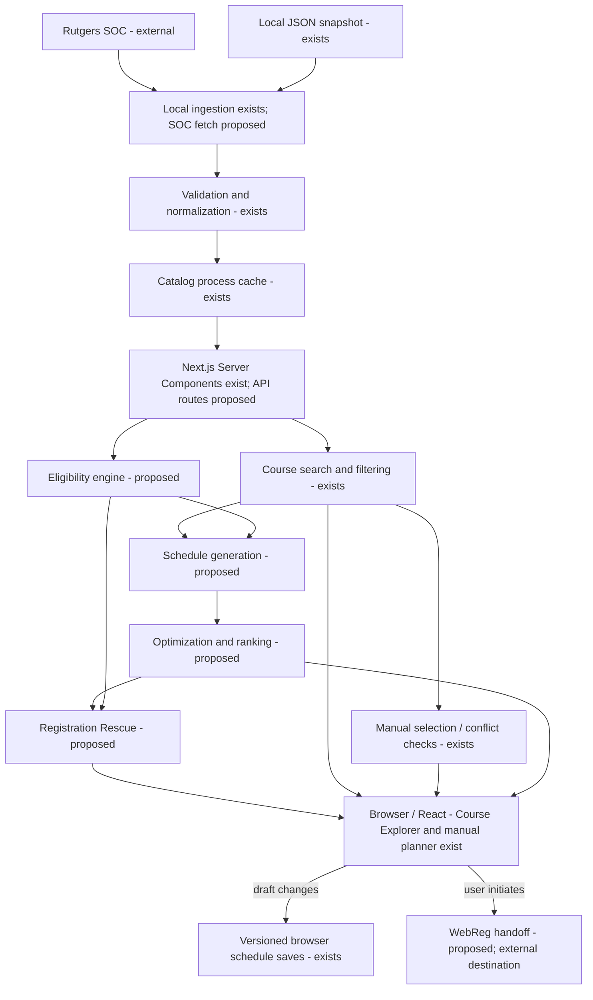
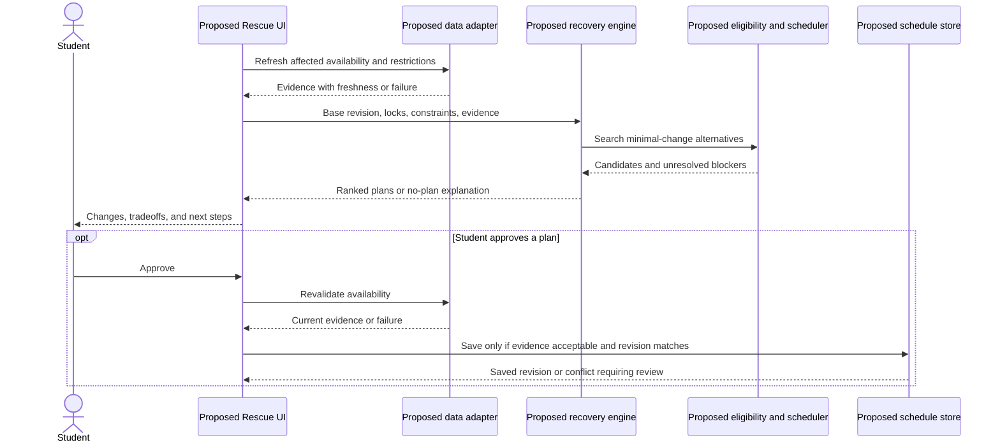

# BetterCSP Architecture

Status: architecture reference and proposed design; repository inspected 2026-11-17.
Development rules and commands remain authoritative in [AGENTS.md](../AGENTS.md).

## 1. Project Overview

BetterCSP is an independent alternative to Rutgers CSP: a fast, intelligent, reliable
scheduler that simplifies registration preparation and helps students recover from complications.
Prevent problems, explain restrictions and failures, provide actionable alternatives, and preserve
existing schedules whenever possible. Correctness, speed, accessibility, and user trust come first.

| Architecture summary | Current state / intended direction |
| --- | --- |
| Implemented | Course Explorer and interactive `/planner`, shared catalog search/details, deterministic meeting conflict checks, local schedule saves |
| Proposed data flow | SOC → validated normalization → search / eligibility / scheduling → recovery → UI |
| Correctness boundary | Deterministic engines; availability and eligibility evaluated separately |
| Persistence | Versioned browser schedule saves scoped to semester/campus; server catalog process cache |
| Registration | User-initiated WebReg handoff; WebReg remains the final authority |

## 2. Technology Stack

| Technology | Verified configuration / status |
| --- | --- |
| Next.js | `16.2.4`, App Router; `app/page.tsx` renders paginated course search |
| React / React DOM | `19.2.4`; `app/layout.tsx` provides layout, Geist fonts, BetterCSP metadata |
| TypeScript | `^5`, strict mode, root `@/*` alias in `tsconfig.json` |
| Styling | Tailwind `^4`, `app/globals.css`, `postcss.config.mjs`; light/dark variables |
| Tooling | ESLint 9, Next core-web-vitals/TypeScript presets in `eslint.config.mjs` |
| Hosting | Vercel is the intended deployment target; no deployment verified |
`next.config.ts` includes local Rutgers JSON in server deployment traces. `package.json` adds
`npm test` for catalog and scheduling behavior using Node's native TypeScript test runner (Node >=22.18; verified on Node 24).
`lib/rutgers/types.ts` and `normalize.ts` validate raw input and retain unknown fields;
`lib/catalog/types.ts`, `search.ts`, and `server.ts` provide domain types, paginated search,
and a shared per-process load promise with retry after failure. No new packages were added.
`components/catalog/search-controls.tsx` handles debounced URL navigation; `section-list.tsx`
renders server-side section disclosures. `app/courses/[id]/page.tsx` renders course details.
Loading/error/not-found routes cover failure states. Server Components call the adapter directly.
`app/planner/page.tsx` reuses paginated catalog search; `components/planner` supplies interactive
selection and calendar views. `app/api/planner/sections/route.ts` resolves at most 100 saved section
identities against the same catalog. There is no live SOC ingestion, automatic generation,
authentication, or database.
Read relevant installed Next.js guides before implementation, as required by `AGENTS.md`.

## 3. High-Level System Architecture

The local catalog → normalization → search → Course Explorer and manual planner paths exist.
Automatic scheduling, eligibility evaluation, and recovery engines remain proposed.
Keep pure domain engines independent of React, network clients, and storage adapters.


Existing boundaries: `lib/rutgers` (raw types/normalization), `lib/catalog` (data access/search),
`components/catalog` (shared search controls/section views), `lib/scheduling` (meeting semantics,
conflict detection, selection updates, save validation/client projections), `components/planner`
(workspace/calendar), and `app/api/planner/sections` (read-only saved-ID resolution).
Proposed only: `lib/eligibility`, `lib/recovery`, and durable persistence. Do not create empty modules.
Use shared typed inputs/results so the same deterministic engines can run outside Next.js.

## 4. Rutgers Course Data

Existing file: `data/rutgers/spring-2027.json`, a top-level array of **4,605 course records**
and **11,528 section records**, 20,431,012 bytes. Counts were computed from the file.
This is Spring 2027 New Brunswick development data; it does not establish live availability.

Public endpoints supplied for integration (not fetched or behavior-verified in this review):
- [Courses](https://classes.rutgers.edu/soc/api/courses.json?year=2027&term=1&campus=NB)
- [Open sections](https://classes.rutgers.edu/soc/api/openSections.json?year=2027&term=1&campus=NB)

| Concern | Observed raw fields / normalization rule proposed |
| --- | --- |
| Course identity | `courseString` such as `01:013:140`; also `offeringUnitCode`, `subject`, `courseNumber`, `supplementCode`, `mainCampus`, `campusCode` |
| Identity caveat | Only 4,593 distinct `courseString` values; preserve source variants and investigate before merging |
| Section identity | `index` is a string such as `13139`, unique among this snapshot's 11,528 sections; `number` such as `01` is a display label |
| Registration index | Preserve leading zeros; scope keys by year/term/campus plus index; uniqueness across terms/campuses is not established |
| Credits | `credits` is numeric or null (476 null records); `creditsObject` includes `BA` / credits by arrangement; do not coerce unknown to zero |
| Meetings | `meetingTimes` includes `meetingDay`, `startTimeMilitary`, `endTimeMilitary`, mode, building, room, campus fields |
| Time examples | `1740`–`1900` military strings; alternative `0540`–`0700` plus `pmCode: P`; prefer validated military values |
| Missing times | Blank days occur 6,186 times; `baClassHours: B` occurs. Missing timing is unresolved, not automatically asynchronous or conflict-free |
| Modes / locations | `LEC`, `RECIT`, `LAB`, online instruction and other modes; campuses include CAC, ONL, DNB; online does not imply asynchronous |
| Instructors | `instructors: [{name: ...}]` and `instructorsText`; no stable instructor ID observed |
| Prerequisites | `preReqNotes` contains text and HTML-like `<em> OR </em>`; `sectionNotes` can mention placement tests; not a verified machine-readable requirement graph |
| Restrictions | `majors`, `minors`, `unitMajors`, `openToText`, `sectionEligibility` (e.g. `JUNIORS AND SENIORS`); code direction/combinations need verification |
| Honors | `sectionCourseType` values H/O/T and `honorPrograms` code arrays; H appears with empty programs. These are signals, not verified eligibility rules |
| Permission | `specialPermissionAddCode` examples `03`/`04`, descriptions `Department staff`/`Instructor`; drop codes also exist; exact enforcement needs verification |
| Cross-listing | `crossListedSections` carries `registrationIndex`, `primaryRegistrationIndex`, course/section/unit/subject fields; `crossListedSectionType` has values 0–6 of unverified meaning |
| Availability | Section `openStatus` is boolean, `openStatusText` OPEN/CLOSED; course `openSections` is a summary; neither proves student eligibility |
Retain raw records separately from normalized domain records, including notes, original codes,
source identity, schema version, and ingestion time. Fetch time does not prove Rutgers update time.
Validate external shapes, IDs, time bounds, nulls, and references; report rejected/unresolved records.
Sanitize or render notes as text. Never silently discard restrictive metadata.
Cache catalog and availability independently by term/campus with timestamps and explicit stale/error
states. Verify the open-sections response shape and completeness before interpreting an absent index
as closed. On failure retain last-known data with a stale warning; never present it as refreshed.

## 5. Proposed Data Models

Future engine contracts below are conceptual; current Course/Section/Meeting types live in
`lib/catalog/types.ts`. Current IDs scope course code + campus + supplement to the source term,
and section registration indexes to that source. All 4,605 course identities are collision-free.
Unknown values remain explicit; evidence references point to retained source records/fields.

```ts
type EligibilityStatus = "no-known-blocker" | "requires-permission"
  | "potentially-ineligible" | "unknown";
interface Course {
  id: string; termKey: string; sourceRecordKeys: string[]; courseString: string;
  title: string; credits: number | null; creditsLabel?: string;
  sectionIds: string[]; prerequisiteText: string | null;
}
interface Section {
  id: string; courseId: string; registrationIndex: string; number: string;
  meetings: Meeting[]; instructors: Instructor[]; restrictions: CourseRestriction[];
  crossListedIndexes: string[]; primaryRegistrationIndex?: string;
  linkage: { status: "verified" | "unknown"; requiredSectionIds: string[] };
  availability: { status: "open" | "closed" | "unknown"; observedAt: string; stale: boolean };
}
interface Meeting {
  day: number | null; startMinute: number | null; endMinute: number | null;
  mode: string; timing: "scheduled" | "verified-asynchronous" | "unknown";
  campusCode: string | null; building?: string; room?: string;
  dateRange?: { start: string; end: string }; // Only when verified.
}
interface Instructor { name: string }
interface CourseRestriction {
  kind: "honors" | "prerequisite" | "permission" | "major-school"
    | "placement" | "linked-section" | "other";
  text: string; rawCode?: string; evidenceRefs: string[];
  interpretation: "verified" | "unverified";
}
interface Schedule {
  id: string; termKey: string; sectionIds: string[]; registeredSectionIds: string[];
  revision: number; catalogVersion: string;
}
interface SchedulePreference {
  hard: { unavailable: Meeting[]; requiredCourseIds: string[];
    lockedSectionIds: string[]; creditRange?: [number, number] };
  soft: { compactness: number; preferredDays: number[];
    earliestMinute?: number; latestMinute?: number; commuteWeight: number };
}
interface EligibilityResult {
  sectionId: string; status: EligibilityStatus;
  findings: { status: EligibilityStatus; reason: string; evidenceRefs: string[];
    nextStep: string }[]; evaluatedAt: string; ruleVersion: string;
}
interface ScheduleConflict {
  kind: "time" | "travel" | "linked-section" | "duplicate-credit" | "unknown-time";
  sectionIds: string[]; explanation: string; blocking: boolean;
}
interface RecoveryPlan {
  baseScheduleId: string; baseRevision: number; candidate: Schedule;
  changes: { removed: string[]; added: string[] }; tradeoffs: string[];
  unresolved: string[]; availabilityObservedAt: string; requiresApproval: true;
}
```
Do not infer source course merges from identical labels. The implemented adapter preserves campus/supplement variants. Keep student-supplied context optional and separate from SOC.

## 6. Scheduling Engine

### Implemented Phase 2: manual planning

`lib/scheduling/meetings.ts` contains shared day/time formatting, complete-meeting validation,
and deterministic pairwise half-open interval conflict detection. Military-time parsing remains
in `lib/rutgers/normalize.ts`. Every meeting in the selected registration index is retained;
lectures, recitations, and labs are not treated as alternative choices. Unknown day/time values
remain unresolved and are listed separately from the calendar. Scheduled online meetings count
for overlaps. The calendar shows seven days, Eastern time, expands to selected hours, and uses
separate lanes for overlapping blocks. Conflicting selections remain available for review.

`lib/scheduling/selection.ts` provides compact catalog-derived client types and pure selection
updates. There is one section per exact normalized course identity; choosing another replaces
only that course's section. Campus/supplement variants retain separate identities. Cross-listed
equivalence and separate required-section linkage are **unverified**: no pairing is inferred from
section labels, no equivalent enrollment identities are silently merged. All supplied source
restriction/linkage notices are available through the shared section disclosures. Eligibility,
commute gaps, and session date ranges are not evaluated; the UI explains these limits.

### Proposed automatic generation (later phase)
Proposed pipeline: selected course IDs → candidate section bundles → hard-constraint filtering →
conflict search → deduplication → deterministic preference ranking with explanations.

- A raw section includes multiple meeting rows: check all lectures, recitations, and labs together.
  Separate index linkages must come from verified rules; never pair sections by numbering guesses.
- Preserve cross-listed enrollment identities and restrictions. Verified equivalent offerings may
  share conflict computations, but must not be selected twice for duplicate credit or silently swapped.
- Hard constraints: selected required courses, locked/registered sections, verified linkages,
  time overlap, user blocks, credit bounds when known, and verified eligibility blockers.
  Unknown credits/times/linkages produce unresolved results rather than a certified valid schedule.
- Availability policy is explicit: closed sections can be backups, not registration-ready candidates.
  Unknown eligibility must remain visible even if a timetable is otherwise conflict-free.
- Compare half-open intervals `[start, end)` on matching days and overlapping date ranges.
  Day labels H = Thursday and U = Sunday were verified against official SOC day-filter labels;
  preserve unknown day codes without guessing.
- Normalize meetings once; precompute candidate conflict adjacency/bitsets for selected courses.
  Search the course with fewest candidates first, propagate exclusions, and prune infeasible branches.
- Avoid Cartesian products over the whole catalog. Generate only selected-course bundles; use bounded
  top-K results, deterministic budgets/tie-breaks, and cancellation. Report truncation/incompleteness.
- Deduplicate by canonical enrollment-bundle IDs, not calendar appearance alone; retain distinct
  registration choices. Use stable ID order to break equal ranks and reproduce results.
- Soft preferences: compactness, days, start/end times, and later commute scoring. Score valid
  candidates with documented weights; a soft score never overrides a hard constraint.

## 7. Registration Eligibility Engine

Proposed rules return findings with source evidence, uncertainty, and a next action; no guaranteed eligibility.

| Status | Meaning / action |
| --- | --- |
| No known blocker | Supported checks found no blocker; still verify with WebReg |
| Requires permission | Verified rule requires permission/SPN; explain how to seek it |
| Potentially ineligible | Evidence conflicts with supplied student context; review restriction |
| Unknown / needs verification | Missing context, unsupported code, or ambiguous requirement; verify officially |
Evaluate honors program membership, prerequisites, add permission/SPNs, major/school/year,
placement, and linked-section requirements independently. Honor codes and H flags trigger review;
section numbers or titles alone cannot establish honors rules. Prerequisite prose is a warning
until its logic and the student's completion/placement evidence can be verified.
Keep every finding; use a documented summary precedence (potentially ineligible, permission,
unknown, then no known blocker). Missing evidence cannot yield a positive eligibility claim.
An open section may still be restricted. WebReg remains authoritative even after all local checks.

## 8. Registration Rescue Engine
Proposed triggers: closure, unexpected restriction, conflict, no viable section for a required
course, or loss of several planned courses. Reuse scheduling/eligibility rules rather than fork them.

1. Capture the base schedule revision, registered/locked sections, constraints, and fresh-or-stale evidence.
2. Freeze registered classes first. Try replacement bundles for only the problematic section.
3. If necessary, expand affected courses incrementally; never silently remove a required course or lock.
4. Reject hard-constraint violations; retain unresolved conditions visibly, outside verified viable plans.
5. Rank lexicographically: preserve registered classes, minimize changed courses/sections, then soft scores.
6. Explain changes, stale evidence, permissions, and tradeoffs. If no plan exists, explain blockers and
   offer explicit user-controlled constraint relaxation or required-course alternatives for review.
7. Require approval before changing a saved schedule; reject obsolete base revisions and revalidate
   availability before saving. A save is not enrollment and cannot reserve a seat.



## 9. Frontend Architecture and UX
Implemented `/planner`: course search/selection beside a weekly calendar on desktop, with a
course/calendar button switcher below 1000px. Existing catalog search controls and section disclosures
are extended rather than duplicated. Calendar blocks link to selected section details; remove and
replace preserve unrelated choices. The Course Explorer remains at `/`. Existing Geist typography,
spacing, and components are retained; accent colors now use Rutgers scarlet (`#cc0033`).
Schedule comparison, preference controls, readiness review, and Rescue Mode remain proposed.
Use focused panels and progressive disclosure; avoid cluttered dashboards and unnecessary animation.
Keep domain results outside rendering logic. Show loading, empty, failure, stale, and partial-result states.
Provide keyboard controls, visible focus, semantic labels, accessible list alternatives to calendar drag,
and textual conflict/restriction explanations; never rely on color alone. Preserve selection during errors.

## 10. Application State and Persistence

| State | Owner / lifecycle (future items marked proposed) |
| --- | --- |
| Catalog/search results | Server-fetched, normalized, versioned; URL filters for shareable search |
| Schedule selections | Client draft; derive meetings/conflicts rather than duplicate them |
| Preferences | Proposed client state and versioned save |
| Saved schedules | Implemented versioned localStorage draft; export/import and revision checks proposed |
| Availability | Current development snapshot; separate refresh and freshness metadata proposed |
| Eligibility | Source warnings implemented; rules and student-context evaluation proposed |
Implemented browser saves use `bettercsp:planner:v1:<year-term-campus>` and store only version,
source ID, and section IDs. On hydration, saved data is validated and resolved through the catalog
endpoint before editing or saving is enabled, preventing an empty initial render from overwriting
an existing save. Missing IDs remain saved and visibly unresolved until explicitly removed.
Read/restore failures retain the previous save and offer retry or an explicit new schedule;
write failures keep the draft in memory with a warning. Saves do not sync across devices and can
be cleared by browser settings. Concurrent tabs are last-writer-wins; there is no revision merging.
Export/import, multiple named schedules, and cross-device saves remain proposed.
Begin without accounts or a database. Add authenticated durable storage only for justified cross-device
requirements. Multi-instance shared caching is a later deployment decision; process memory is disposable.

## 11. Performance and Scalability

- Keep the approximately 20 MB raw catalog server-only; return targeted, paginated normalized queries.
- Precompute compact per-term lookup/search structures; begin with simple indexing, measure before
  adopting an external search service. Cache immutable catalog versions separately from availability.
- Bound query sizes, scheduling work, and response payloads; reuse precomputed conflicts and pruning.
- Refresh time-sensitive availability separately; coalesce requests, back off, and show stale fallback.
- Keep client state scoped, derived values memoized when costly, and result identities stable.
  Lazy-load heavy comparison/rescue UI and use workers only if measured CPU work blocks interaction.
- Verify Vercel artifact size, runtime limits, and cache behavior before deployment; do not assume
  importing the raw JSON into a route or component is a suitable production loading strategy.

## 12. Security, Privacy, and External Integrations

Proposed integrations fetch Rutgers on the server using fixed/allowlisted endpoints, timeouts,
bounded responses, validation, respectful caching, and request limits. Do not accept arbitrary fetch URLs.
Treat all SOC notes/HTML and imported schedules as untrusted input; render safe text and validate imports.
Collect minimal student context; do not collect Rutgers credentials or store transcripts by default.
Do not bypass authentication or automate enrollment transactions. WebReg handoff must be user-initiated,
use a verified official destination, and explain that login/registration happens there. Do not invent
prefill/deep-link support or send personal context in URLs. Only local snapshot ingestion is implemented; no external Rutgers requests or WebReg handoff exists.

## 13. Testing Strategy

Implemented: `lib/catalog/catalog.test.ts` uses `node:test` for normalization, full snapshot counts,
identity collisions, Calculus meetings/indexes, unknown metadata, honors signal boundaries,
nullable credits, malformed input, search/filtering, and pagination. Remaining behavior tests:
- Normalization: nullable credits, duplicate course identities, unknown codes, malformed rows, HTML notes.
- Eligibility: honors signals with/without program data, permission, prerequisites, placement, major/school,
  contradictory evidence, missing context, and open-but-restricted sections.
- Conflicts/linkage: interval boundaries, blank timing, online timed meetings, date ranges, linked bundles,
  cross-listed duplicate credit, and verified campus travel requirements.
- Generation: deterministic order, hard constraints, no duplicates, cancellation/truncation; compare small
  fixtures against exhaustive enumeration to detect invalid results and missing valid combinations.
- Recovery: immutable registered classes, minimal-change ordering, no viable plan, multiple failures,
  approval required, stale base revisions, and closure between proposal and save.
- Data/UI: timeout, stale cache, invalid response, changing availability; keyboard search/calendar,
  readiness warnings, save/load failures, and approving or rejecting rescue plans.
Use representative small fixtures and injected clocks/adapters; avoid live SOC dependency in unit tests.

## 14. Implementation Roadmap

Phase 1 local-snapshot Course Explorer is implemented; live ingestion remains future work.
Phases 2–5 remain **planned**; no scheduling or registration decision engine exists.

| Phase | Scope / completion evidence needed |
| --- | --- |
| 1 — Foundation | Local ingestion/normalization, variant identities, search/filtering and section details tested; API fetching deferred |
| 2 — Scheduling | Conflict/linkage handling, deterministic generation, weekly calendar, preference ranking |
| 3 — Registration Intelligence | Eligibility classification, verified honors rules, prerequisite warnings, readiness |
| 4 — Registration Rescue | Suggested automatic repair, backups, approval-based recovery workflows |
| 5 — Advanced Features | Verified commute scoring, optional accounts, course monitoring, optional AI assistance |
AI may explain results or assist discovery; it must not decide scheduling correctness or eligibility.

## 15. Architecture Decision Records

Compact decision log; status describes policy/design, not implementation completion. Date: 2026-11-17.

| Decision | Status | Rationale / alternative considered |
| --- | --- | --- |
| Retain Next.js | Existing stack | Reuse App Router scaffold for UI and future server adapters; avoid a separate frontend/backend stack initially |
| Deterministic scheduling | Required design | Reproducible constraints and testable outcomes; AI generation cannot establish correctness |
| Separate availability/eligibility | Required design | An open seat does not establish student eligibility; reject a combined enrollable boolean |
| Minimize recovery changes | Required design | Preserve registered classes and user effort; avoid regenerating an unrelated schedule |
| Prefer SOC API | Proposed integration | Public structured course inputs already match the snapshot; avoid brittle CSP UI scraping; verify endpoint contract |
| Minimal dependencies | Required design | Reuse installed tools and defer infrastructure until justified; avoid mandatory DB/auth/search services |

## 16. Known Limitations and Open Questions

- Verify restriction code semantics, precedence, inclusion/exclusion direction, and honors membership rules.
- Current source/code/campus/supplement IDs are unique in this snapshot; verify that contract for future terms.
- Verify lecture/recitation/lab linkage and cross-listing type/primary-index behavior before bundling.
- Confirm arranged/online timing, session dates, variable credits, and campus travel data.
- Establish SOC update cadence, availability endpoint shape, cache headers/rate guidance, and outage behavior.
- No historical availability series exists here; the single snapshot cannot predict seat openings.
- Verify permitted WebReg handoff capabilities; no enrollment API or deep-link contract is established.
- No verified deployment, shared cache, durable store, accounts, monitoring, scheduling or eligibility
  engine exists. Current process cache is disposable; snapshot capture time is unknown.

Sources inspected: `AGENTS.md`, `CLAUDE.md`, `README.md`, `package.json`, `tsconfig.json`,
`next.config.ts`, `eslint.config.mjs`, `postcss.config.mjs`, `app/page.tsx`, `app/layout.tsx`,
`app/globals.css`, and targeted schema/value/count extraction from `data/rutgers/spring-2027.json`.
Day-code source: [official Rutgers SOC day filters](https://classes.rutgers.edu/soc/) (verified 2026-11-17).
This new reference consolidates verified baseline and explicitly requested design in one place;
keep it current when implementation changes, without duplicating agent workflow rules.
