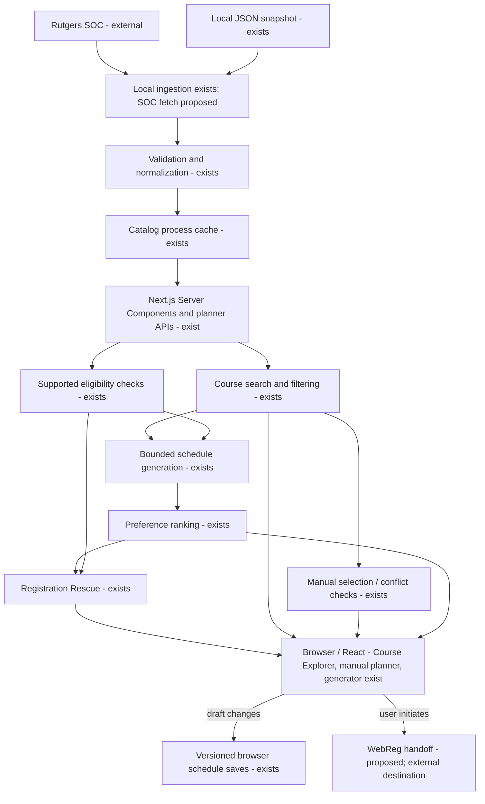

# BetterCSP Architecture

Status: architecture reference and proposed design; repository inspected 2026-11-17.
Development rules and commands remain authoritative in [AGENTS.md](../AGENTS.md).

## 1. Project Overview

BetterCSP is an independent alternative to Rutgers CSP: a fast, intelligent, reliable
scheduler that simplifies registration preparation and helps students recover from complications.
Prevent problems, explain restrictions and failures, provide actionable alternatives, and preserve
existing schedules whenever possible. Correctness, speed, accessibility, and user trust come first.

| Architecture summary | Current state / intended direction |
| --- | --- |
| Implemented | Course Explorer and interactive `/planner`, shared catalog search/details, deterministic conflict checks and ranked generation, local schedule saves and locks |
| Proposed data flow | SOC → validated normalization → search / eligibility / scheduling → recovery → UI |
| Correctness boundary | Deterministic engines; availability and eligibility evaluated separately |
| Persistence | Versioned browser schedule saves scoped to semester/campus; server catalog process cache |
| Registration | User-initiated WebReg handoff; WebReg remains the final authority |

## 2. Technology Stack

| Technology | Verified configuration / status |
| --- | --- |
| Next.js | `16.2.4`, App Router; `app/page.tsx` renders paginated course search |
| React / React DOM | `19.2.4`; `app/layout.tsx` provides layout, Geist fonts, BetterCSP metadata |
| TypeScript | `^5`, strict mode, root `@/*` alias in `tsconfig.json` |
| Styling | Tailwind `^4`, `app/globals.css`, `postcss.config.mjs`; light/dark variables |
| Tooling | ESLint 9, Next core-web-vitals/TypeScript presets in `eslint.config.mjs` |
| Hosting | Vercel is the intended deployment target; no deployment verified |
`next.config.ts` includes local Rutgers JSON in server deployment traces. `package.json` adds
`npm test` for catalog and scheduling behavior using Node's native TypeScript test runner (Node >=22.18; verified on Node 24).
`lib/rutgers/types.ts` and `normalize.ts` validate raw input and retain unknown fields;
`lib/catalog/types.ts`, `search.ts`, and `server.ts` provide domain types, paginated search,
and a shared per-process load promise with retry after failure. No new packages were added.
`components/catalog/search-controls.tsx` handles debounced URL navigation; `section-list.tsx`
renders server-side section disclosures. `app/courses/[id]/page.tsx` renders course details.
Loading/error/not-found routes cover failure states. Server Components call the adapter directly.
`app/planner/page.tsx` reuses paginated catalog search; `components/planner` supplies interactive
selection and calendar views. `app/api/planner/sections/route.ts` resolves at most 100 saved section
identities against the same catalog. `POST /api/planner/generate` validates and resolves generation
choices against the server catalog, returning bounded ranked alternatives. There is no live SOC
ingestion, official student-record verification, authentication, or database. Phase 4 adds bounded,
evidence-backed checks in `lib/eligibility`; WebReg remains authoritative.
Read relevant installed Next.js guides before implementation, as required by `AGENTS.md`.

## 3. High-Level System Architecture

The local catalog → normalization → search → Course Explorer and manual planner paths exist.
Bounded generation/ranking and supported eligibility checks are implemented; minimum-change recovery is implemented; official registration transactions remain external.
Keep pure domain engines independent of React, network clients, and storage adapters.


Existing boundaries: `lib/rutgers` (raw types/normalization), `lib/catalog` (data access/search),
`components/catalog` (shared search controls/section views), `lib/scheduling` (meeting semantics,
conflict detection, selection updates, save validation/client projections), `components/planner`
(workspace/calendar/generation controls), `app/api/planner/sections` (saved-ID resolution), and
`app/api/planner/generate` (bounded computation).
Implemented `lib/eligibility` is independent of scheduling/React; implemented `lib/recovery` adds protected repairs; durable cross-device persistence remains proposed. Do not create empty modules.
Use shared typed inputs/results so the same deterministic engines can run outside Next.js.

## 4. Rutgers Course Data

Existing file: `data/rutgers/spring-2027.json`, a top-level array of **4,605 course records**
and **11,528 section records**, 20,431,012 bytes. Counts were computed from the file.
This is Spring 2027 New Brunswick development data; it does not establish live availability.

Public endpoints supplied for integration (not fetched or behavior-verified in this review):
- [Courses](https://classes.rutgers.edu/soc/api/courses.json?year=2027&term=1&campus=NB)
- [Open sections](https://classes.rutgers.edu/soc/api/openSections.json?year=2027&term=1&campus=NB)

| Concern | Observed raw fields / normalization rule proposed |
| --- | --- |
| Course identity | `courseString` such as `01:013:140`; also `offeringUnitCode`, `subject`, `courseNumber`, `supplementCode`, `mainCampus`, `campusCode` |
| Identity caveat | Only 4,593 distinct `courseString` values; preserve source variants and investigate before merging |
| Section identity | `index` is a string such as `13139`, unique among this snapshot's 11,528 sections; `number` such as `01` is a display label |
| Registration index | Preserve leading zeros; scope keys by year/term/campus plus index; uniqueness across terms/campuses is not established |
| Credits | `credits` is numeric or null (476 null records); `creditsObject` includes `BA` / credits by arrangement; do not coerce unknown to zero |
| Meetings | `meetingTimes` includes `meetingDay`, `startTimeMilitary`, `endTimeMilitary`, mode, building, room, campus fields |
| Time examples | `1740`–`1900` military strings; alternative `0540`–`0700` plus `pmCode: P`; prefer validated military values |
| Untimed meetings | `baClassHours: B` plus blank day/times and online/remote campus O/T means asynchronous content per SOC; other untimed B meetings are arranged. Unsupported/partial timing remains unresolved |
| Modes / locations | `LEC`, `RECIT`, `LAB`, online instruction and other modes; campuses include CAC, ONL, DNB; online does not imply asynchronous |
| Instructors | `instructors: [{name: ...}]` and `instructorsText`; no stable instructor ID observed |
| Prerequisites | `preReqNotes` contains text and HTML-like `<em> OR </em>`; `sectionNotes` can mention placement tests; not a verified machine-readable requirement graph |
| Restrictions | `majors`, `minors`, `unitMajors`, `openToText`, `sectionEligibility` (e.g. `JUNIORS AND SENIORS`); code direction/combinations need verification |
| Delivery / honors | `sectionCourseType`: H = hybrid, O = online/remote, T = traditional/face-to-face. Separate explicit honors section notes and `honorPrograms` evidence from delivery; program-code rules remain unverified |
| Permission | `specialPermissionAddCode` examples `03`/`04`, descriptions `Department staff`/`Instructor`; drop codes also exist; exact enforcement needs verification |
| Cross-listing | `crossListedSections` carries `registrationIndex`, `primaryRegistrationIndex`, course/section/unit/subject fields; `crossListedSectionType` has values 0–6 of unverified meaning |
| Availability | Section `openStatus` is boolean, `openStatusText` OPEN/CLOSED; course `openSections` is a summary; neither proves student eligibility |
Retain raw records separately from normalized domain records, including notes, original codes,
source identity, schema version, and ingestion time. Fetch time does not prove Rutgers update time.
Validate external shapes, IDs, time bounds, nulls, and references; report rejected/unresolved records.
Sanitize or render notes as text. Never silently discard restrictive metadata.
Cache catalog and availability independently by term/campus with timestamps and explicit stale/error
states. Verify the open-sections response shape and completeness before interpreting an absent index
as closed. On failure retain last-known data with a stale warning; never present it as refreshed.

Phase 2.5 evidence, conservative classification rules, and unknown code meanings are recorded in
[Rutgers data audit](RUTGERS_DATA_AUDIT.md). Shared section disclosures show delivery separately from
honors evidence, readable cross-listings/comments, and source restrictions. Raw metadata is retained.

## 5. Proposed Data Models

Future engine contracts below are conceptual; current Course/Section/Meeting types live in
`lib/catalog/types.ts`. Current IDs scope course code + campus + supplement to the source term,
and section registration indexes to that source. All 4,605 course identities are collision-free.
Unknown values remain explicit; evidence references point to retained source records/fields.

```ts
type EligibilityStatus = "no-known-blocker" | "requires-permission"
  | "potentially-ineligible" | "unknown";
interface Course {
  id: string; termKey: string; sourceRecordKeys: string[]; courseString: string;
  title: string; credits: number | null; creditsLabel?: string;
  sectionIds: string[]; prerequisiteText: string | null;
}
interface Section {
  id: string; courseId: string; registrationIndex: string; number: string;
  meetings: Meeting[]; instructors: Instructor[]; restrictions: CourseRestriction[];
  crossListedIndexes: string[]; primaryRegistrationIndex?: string;
  linkage: { status: "verified" | "unknown"; requiredSectionIds: string[] };
  availability: { status: "open" | "closed" | "unknown"; observedAt: string; stale: boolean };
}
interface Meeting {
  day: number | null; startMinute: number | null; endMinute: number | null;
  mode: string; timing: "scheduled" | "verified-asynchronous" | "unknown";
  campusCode: string | null; building?: string; room?: string;
  dateRange?: { start: string; end: string }; // Only when verified.
}
interface Instructor { name: string }
interface CourseRestriction {
  kind: "honors" | "prerequisite" | "permission" | "major-school"
    | "placement" | "linked-section" | "other";
  text: string; rawCode?: string; evidenceRefs: string[];
  interpretation: "verified" | "unverified";
}
interface Schedule {
  id: string; termKey: string; sectionIds: string[]; registeredSectionIds: string[];
  revision: number; catalogVersion: string;
}
interface SchedulePreference {
  hard: { unavailable: Meeting[]; requiredCourseIds: string[];
    lockedSectionIds: string[]; creditRange?: [number, number] };
  soft: { compactness: number; preferredDays: number[];
    earliestMinute?: number; latestMinute?: number; commuteWeight: number };
}
interface EligibilityResult {
  sectionId: string; status: EligibilityStatus;
  findings: { status: EligibilityStatus; reason: string; evidenceRefs: string[];
    nextStep: string }[]; evaluatedAt: string; ruleVersion: string;
}
interface ScheduleConflict {
  kind: "time" | "travel" | "linked-section" | "duplicate-credit" | "unknown-time";
  sectionIds: string[]; explanation: string; blocking: boolean;
}
interface RecoveryPlan {
  baseScheduleId: string; baseRevision: number; candidate: Schedule;
  changes: { removed: string[]; added: string[] }; tradeoffs: string[];
  unresolved: string[]; availabilityObservedAt: string; requiresApproval: true;
}
```
Do not infer source course merges from identical labels. The implemented adapter preserves campus/supplement variants. Keep student-supplied context optional and separate from SOC.

## 6. Scheduling Engine

### Implemented Phase 2: manual planning

`lib/scheduling/meetings.ts` contains shared day/time formatting, complete-meeting validation,
and deterministic pairwise half-open interval conflict detection. Military-time parsing remains
in `lib/rutgers/normalize.ts`. Every meeting in the selected registration index is retained;
lectures, recitations, and labs are not treated as alternative choices. Meetings carry explicit
scheduled/asynchronous/arranged/unknown timing. Evidenced asynchronous
components stay off the calendar without missing-time warnings; arranged meetings explain instructor
coordination and unresolved overlaps. Unknown day/time values retain verification warnings.
Conflicting B flags and supplied intervals produce a source warning while preserving timed checks.
Scheduled online meetings count for overlaps. The calendar shows seven days, Eastern time, expands to selected hours, and uses
separate lanes for overlapping blocks. Conflicting selections remain available for review.

`lib/scheduling/selection.ts` provides compact catalog-derived client types and pure selection
updates. There is one section per exact normalized course identity; choosing another replaces
only that course's section. Campus/supplement variants retain separate identities. Cross-listed
equivalence and separate required-section linkage are **unverified**: no pairing is inferred from
section labels, no equivalent enrollment identities are silently merged. All supplied source
restriction/linkage notices are available through the shared section disclosures. Eligibility,
commute gaps, and session date ranges are not evaluated; the UI explains these limits.

### Implemented Phase 3: bounded generation and ranking

`generation-types.ts` defines the typed request/results; `generation-request.ts` validates API and
engine inputs without adding dependencies. `candidates.ts` applies hard constraints to whole
registration indexes; `relationships.ts` conservatively groups explicit cross-listed course codes
and surfaces linkage prose without deriving enrollment rules. `generate.ts` runs depth-first
constraint search with smallest-domain ordering, lazy cached pair conflicts, forward checking,
optional-course omission, and a bounded top-K set. It never materializes a Cartesian product.

Limits: 12 total courses (including locked/retained selections), 2,000 filtered candidates, and at
most 10,000 cached section-pair results. The planner opts into discovery with `discoveryCursor: null`.

**Checkpointed discovery.** The first window uses the existing candidate order and ranking. It
keeps up to 60 recommendations and returns up to ten. While that shortlist has entries, subsequent
requests read the next ten from the cursor with no search work. Afterward, each request resumes at
the next unfinished DFS branch and returns up to ten recommendations from one new search window.
Each page keeps its original order. Later pages may score better. Valid leaves that miss a window's
shortlist are counted but do not become browseable.

A checkpoint stores the chosen candidate or omission ordinal at each ancestor and the next ordinal
at the current depth. Candidate domains are rebuilt from the validated request. A branch interrupted
during forward checking is retried, but only completed branch decisions advance the frontier.
The solver charges one step for a candidate attempt, one for a compatibility probe (including each
forward-check probe), and one on entry to a feasible child or scored leaf. The initial root costs
one step. It caps windows at 25,000 steps and a session at 12 windows and 170 recommendations.
Buffer-only requests use zero search steps. Global uniqueness of normalized section IDs and a
single traversal of each course/omission assignment prevent duplicates across windows.

Discovery reports the product of filtered domain sizes (including optional omissions) as an upper
bound before conflict and cross-list checks. It tracks attempted final choices, unique valid
timetables, shortlisted and loaded results, and cumulative and per-request steps separately.
Exhaustion means that the frontier is empty. A work or session limit can leave unexplored branches,
even when all currently shortlisted results are visible.

**Deployment.** Set server-only `PLANNER_DISCOVERY_SECRET` to a stable random value of at least
32 bytes for each enabled Vercel environment, for example a value generated by `openssl rand -hex 32`.
All instances serving the same environment need the same key. Without it, the planner retains
the prior replay pagination for the initial shortlist and the legacy endpoint continues to work.
The 30-minute HMAC-SHA256 cursor is capped at 6,500 characters and binds the versioned frontier,
buffer, and counters to the catalog snapshot's SHA-256 revision and validated request. The body
omits the request and academic profile. Expiration and key rotation require a fresh search.
Bump the cursor version when traversal order, checkpoint semantics, or ranking changes. No
solver state is stored on an instance. Rescue still uses its original minimum-change search.

Hard filters cover earliest start, latest end, required days off, excluded indexes/campuses, and
locks. Every timed lecture/recitation/lab in an index participates. Explicit asynchronous components
need no weekly interval. Arranged, unknown, internally overlapping, and inconsistent-source timings
are excluded with reasons; a locked section that fails a hard rule yields an actionable no-result
state. Unknown campus locations cannot establish compliance with campus exclusions.

Cross-listed course-code relationships are treated transitively and symmetrically; two enrollment
identities from the same known group (including same-code campus/supplement variants) cannot be
selected together. No course identity is silently swapped. Separate required-component rules are
not decoded: source co-requisite/required-registration notes become prominent limitations, and
all generated results require registration review. See the Phase 3 follow-up in the data audit.

`scoring.ts` derives metrics independently from eligibility and availability. Results first maximize
included optional courses, then minimize the sum of user-weighted penalties, then sort by ID:

| Penalty | Quantity multiplied by its weight |
| --- | --- |
| Days off | Number of days with timed classes |
| Later starts | 24 minus the mean first-class start hour across timed class days (0 for no timed classes) |
| Late evenings | Total meeting hours after 7 PM Eastern, using scheduled end times |
| Gaps | Total hours between scheduled classes on the same day |
| Campus changes | Consecutive changes among known physical campus meetings, ignoring online/remote locations |
| Commute days | Distinct days with known physical campus meetings |
| Instructors | Sections without a case-insensitive substring match to any supplied preferred name |

The planner defaults to evening weight 4. Turning it off uses weight 0, also the fallback for legacy
requests. The latest acceptable class end remains an independent hard cutoff.

Contributions are rounded to 0.001 points; lower total penalty is preferred. Missing instructor or
location data limits these preferences, and unknown locations are disclosed. Campus changes are a
preliminary proxy, with no bus travel durations invented. Snapshot status and honors/restriction
information do not alter scores; closed/unknown snapshot sections remain explicitly warned planning
alternatives. Metrics, score contributions, prerequisites/source notices, and limitations accompany
every retained result. Weekly patterns do not verify special session dates or exam obligations.

The UI adds course targets, required/optional choices, progressive preference controls, previews,
previous/next navigation, pinned comparisons, locks, and explicit Apply. All manual courses outside
the target list become fixed contextual locks for generation, so previews account for their meetings.
Results carry a client basis signature; changed targets/settings/locks/draft or a pending replacement
request disables Apply. Apply replaces only targeted choices (including omitted optional targets),
retains contextual/manual sections and explicit locks, and offers an in-memory pre-apply undo until
manual edits. Generation never writes the saved draft automatically. Error/empty/partial states keep
the manual draft intact. Generator targets/preferences/results are session state, not named saves.

Local saves remain version 1, with an optional validated `lockedSectionIds` field. Old ID-only saves
load unchanged; resolved saved IDs receive current metadata. Locks persist per semester/campus with
the draft. Unknown saved IDs must be resolved/removed before generation. No schema/dependency changes
or enrollment transactions were introduced.

Measured locally on Node 24, using the existing cached snapshot (median of five warm runs after
one warm-up; not an HTTP or deployment latency guarantee):

| Courses | Section counts | Solver median | Search steps | Combinations scored | Retained / search |
| --- | --- | --- | --- | --- | --- |
| Data Structures + Multivariable Calculus | 45 × 30 | 3.95 ms | 3,932 | 1,006 | 10 / complete |
| Above + General Physics + College Writing | 45 × 30 × 30 × 99 | 25.95 ms | 25,000 | 6,053 | 10 / truncated |
| Above + Elementary Arabic I + General Psychology | 45 × 30 × 30 × 99 × 2 × 7 | 26.38 ms | 25,000 | 5,045 | 10 / truncated |

## 7. Registration Eligibility Engine

Implemented Phase 4 uses `lib/eligibility/types.ts`, `profile.ts`, `academic-rules.ts`, and
`evaluate.ts`. It consumes normalized course/section metadata, not React or scheduling state, and
returns deterministic findings with stable rule IDs, exact source evidence, links, missing facts,
actionable next steps, and a separate flag for supported explicit incompatibilities.
[Eligibility rules and evidence](ELIGIBILITY_RULES.md) defines the supported grammar and limits.

| Status | Meaning / action |
| --- | --- |
| No known blocker | Supported checks found no blocker; never guaranteed eligibility or enrollment |
| Permission required | Source permission/admission requirement needs approval for the specific index |
| Potentially ineligible | Available evidence conflicts with an explicitly supplied fact; review it |
| Verification needed | Information is missing or the rule/code is unsupported; confirm officially |

Summary precedence is Potentially ineligible, Permission required, Verification needed, then No
known blocker. Findings remain separate, so granted add permission cannot waive prerequisites,
school/major rules, honors admission, or placement. Missing facts are never negative evidence.
Delivery H remains hybrid; Math honors admission uses verified departmental policy and section
identity/designation evidence. Unknown honors-program code meanings stay explicit.

The planner projects the optional academic planning profile into the existing eligibility contract.
Academic information stays outside the versioned local draft save. The profile form validates
optional facts on explicit update. `registration-readiness.tsx` uses the same evaluator for manual
and generated selections. Actionable permission/mismatch findings are prioritized; source details are disclosed
progressively. Source links point to Rutgers instructions or the semester/campus SOC snapshot API.

`GenerationRequest.eligibility` is optional, preserving Phase 3 requests. The parser validates it;
profiles are allowlisted and contradictions rejected. Generation defaults to retaining warnings.
Opt-in exclusion only filters explicit supported standing, complete positive declaration, and
literal Honors College-only mismatches. Unknown or ambiguous eligibility remains a candidate.
Locked incompatible sections yield a visible no-result state and exclusion evidence, not an unlock.
The engine returns assessments with retained schedules and bounded examples of filtered mismatches.
Profile/policy changes join the preview basis signature and disable Apply until regeneration.
Timetable hard filters, eligibility decisions, ranking scores, and snapshot seats remain separate.

Registration Preflight runs in the browser for the actual selected indexes and uses the existing
eligibility evaluator with local planning context. It distinguishes course-level and section-level
evidence, weekly overlaps, published Spring 2027 New Brunswick travel minimums, and snapshot seat
status. The course query on the sections route returns normalized catalog section projections.
Alternative ranking and protected-section handling stay in the client. No preflight profile is sent
with this query. The existing Rescue flow receives the selected index through its replacement intake.
See [Eligibility Rules](ELIGIBILITY_RULES.md) for scope and sources.

## 8. Registration Rescue Engine

Implemented Phase 5 in `lib/recovery`: provenance-aware problem detection, scoped registration
reports, minimum-change staged search, protected apply, and signature-checked undo. It composes
`generateSchedules` and `evaluateEligibility`; the generator's optional internal baseline/change
budget keeps Phase 3's default objective unchanged. Registered self-reports and manual locks are
hard constraints unless per-index exploration and apply-time overrides are explicitly approved.
Original courses stay required. Guided intake separates registration reports from requests to
replace an index. The solver first tries the fewest changed sections for an actionable timetable
problem or requested replacement, then expands only as necessary. Weighted preferences break disruption ties.
Search steps are bounded across stages, and truncated proposals are explicitly best-found only.

`POST /api/planner/rescue` resolves scoped saved IDs and validates the same shared generation/profile
contract. A shared 32 KB JSON reader preserves the generation endpoint's existing input bounds.
`lib/availability` timestamps and caches optional server checks, but the investigated open-sections
response has unverified campus scope/completeness; production recovery remains snapshot-only.
Successful unverified retrievals, stale attempts, first failures, and snapshot-only mode stay distinct.
No unverified absence is inferred closed, and no timestamp implies a guaranteed WebReg seat.

`rescue-panel.tsx`/`rescue-results.tsx` reuse calendar/readiness components, shared preference settings,
source instructions, and the existing design. Full before/after and alternative comparisons precede
explicit approval. Unknown eligibility stays provisional. Applying changes only local selections;
new indexes are Planned. Historical registered reports are retained for explicit WebReg reconciliation,
with further automatic planning paused while those reports remain outside the draft. Undo restores
sections/locks/reports together only when the post-apply signature is unchanged. Stale proposals
cannot be applied. Ordinary generation/manual replacement also respect registered protection.

Version 1 local saves gain optional validated `registrationStatuses` (up to 200 scoped reports);
older saves still load. Academic profile storage is separate and opt-in. Generator settings are
workspace-owned and shared with Rescue; neither preferences nor reports trigger autonomous requests.

Algorithm, availability evidence, performance, approval/undo guarantees, and unresolved rules are
recorded in [Registration Rescue](REGISTRATION_RESCUE.md). No WebReg transaction or monitoring exists.

## 9. Frontend Architecture and UX
`/planner` exposes Build, My Schedule, and Rescue on both desktop and mobile. Build pairs catalog
search and generation on wider screens and focuses the schedule preview after Generate on mobile.
My Schedule holds the saved timetable, registration reports, undo and Preflight. A section's
replacement action opens Rescue for that exact index. Applying a proposal returns to My Schedule.
The `view` parameter and optional public section index participate in browser history. Plain
catalog query URLs open Build. Switching destinations keeps the workspace mounted. Preference and
eligibility details remain in disclosures. The Course Explorer remains at `/`.

Candidate choices remain session-only. Ordinary restored sections are eligible to vary in previews.
A manual pick can be kept for generation during the session, with a visible control to release
unprotected pins. Registered sections and explicit locks are always sent as protected indexes.
Removing a course from Build leaves any saved section intact and fixed in previews until edited
in My Schedule. Generation results distinguish one verified compatible timetable, an available
continuation, and a work or session limit. Saved ID/report/lock formats, undo signatures, and the
signed discovery protocol stay unchanged.
Use focused panels and progressive disclosure; avoid cluttered dashboards and unnecessary animation.
Keep domain results outside rendering logic. Show loading, empty, failure, stale, and partial-result states.
Provide keyboard controls, visible focus, semantic labels, accessible list alternatives to calendar drag,
and textual conflict/restriction explanations; never rely on color alone. Preserve selection during errors.

## 10. Application State and Persistence

| State | Owner / lifecycle (future items marked proposed) |
| --- | --- |
| Catalog/search results | Server-fetched, normalized, versioned; URL filters for shareable search |
| Schedule selections | Client draft; derive meetings/conflicts rather than duplicate them |
| Preferences | Proposed client state and versioned save |
| Saved schedules | Implemented versioned localStorage draft; export/import and revision checks proposed |
| Availability | Current development snapshot; separate refresh and freshness metadata proposed |
| Academic planning profile | Optional versioned browser storage, reusable across semester and campus drafts |
| Eligibility | Existing request contract projected from the active academic profile |
Implemented browser saves use `bettercsp:planner:v1:<year-term-campus>` and store only version,
source ID, section IDs, optional locked section IDs, and scoped self-reported registration statuses. On hydration, saved data is validated and
resolved through the catalog endpoint before editing or saving is enabled, preventing an empty initial render from overwriting
an existing save. Missing IDs remain saved and visibly unresolved until explicitly removed.
Read/restore failures retain the previous save and offer retry or an explicit new schedule;
write failures keep the draft in memory with a warning. Saves do not sync across devices and can
be cleared by browser settings. Concurrent tabs are last-writer-wins; there is no revision merging.
Export/import, multiple named schedules, and cross-device saves remain proposed.

### Academic planning profile

The profile lives in the browser under `bettercsp:academic-profile:v1`. Updating applies information
in the current tab. Checking Remember and updating opts into storage, and a later update with
Remember unchecked removes the stored copy. Clear resets both the form and the saved profile.
Blocked or invalid storage leaves generation and Rescue available. The academic key is independent
of the selected term and campus. Student-reported permission indexes are scoped to the term and
campus where they were entered. Saved schedules and their registration reports still use their
existing storage keys and schema.

`lib/academic/profile.ts` validates the versioned record and reuses the existing eligibility parser.
Planning names for school, major and minor, intended degree, catalog year, current and planned
course lists, and equivalent-credit entries stay in the browser. Only the existing eligibility
fields, including explicitly reported completed courses, are projected into generation and Rescue
requests. Entries marked Rutgers accepted are still student reports that credit was recorded.
They remain separate from unverified credit, completed courses, and requirement matches. The
profile contains no account identifiers, academic documents, grades, or permission numbers.

`lib/academic/requirements.ts` defines catalog-year-specific program models. `rutgers-cs.ts` and
`course-matches.ts` use the reported 2026–27 SAS Computer Science B.A. or B.S. program to identify
degree-relevant alternatives for the Spring 2027 New Brunswick planner. Reported progress and
course relationships stay separate from official requirement completion. The Rescue endpoint
receives the derived shortlist of course codes alongside the existing Rescue inputs. The course
fallback branch fixes every retained index and reuses the generation and Preflight travel checks.
See [Registration Rescue](REGISTRATION_RESCUE.md#degree-aware-course-alternatives) for the
evidence, transition limits, ranking, and apply behavior.

Begin without accounts or a database. Add authenticated durable storage only for justified cross-device
requirements. Multi-instance shared caching is a later deployment decision; process memory is disposable.

## 11. Performance and Scalability

- Keep the approximately 20 MB raw catalog server-only; return targeted, paginated normalized queries.
- Precompute compact per-term lookup/search structures; begin with simple indexing, measure before
  adopting an external search service. Cache immutable catalog versions separately from availability.
- Bound query sizes, scheduling work, and response payloads; reuse precomputed conflicts and pruning.
- Refresh time-sensitive availability separately; coalesce requests, back off, and show stale fallback.
- Keep client state scoped, derived values memoized when costly, and result identities stable.
  Lazy-load heavy comparison/rescue UI and use workers only if measured CPU work blocks interaction.
- Verify Vercel artifact size, runtime limits, and cache behavior before deployment; do not assume
  importing the raw JSON into a route or component is a suitable production loading strategy.

## 12. Security, Privacy, and External Integrations

Proposed integrations fetch Rutgers on the server using fixed/allowlisted endpoints, timeouts,
bounded responses, validation, respectful caching, and request limits. Do not accept arbitrary fetch URLs.
Treat all SOC notes/HTML and imported schedules as untrusted input; render safe text and validate imports.
Collect minimal student context; do not collect Rutgers credentials or store transcripts by default.
Do not bypass authentication or automate enrollment transactions. WebReg handoff must be user-initiated,
use a verified official destination, and explain that login/registration happens there. Do not invent
prefill/deep-link support or send personal context in URLs. Only local snapshot ingestion is implemented; no external Rutgers requests or WebReg handoff exists.

## 13. Testing Strategy

Implemented: `lib/catalog/catalog.test.ts` uses `node:test` for normalization, full snapshot counts,
identity collisions, Calculus meetings/indexes, unknown metadata, honors signal boundaries,
nullable credits, malformed input, search/filtering, and pagination. `lib/scheduling` adds meeting,
generation, ranking, request-boundary, lock/save, and apply tests. The Phase 3 tests include real
Data Structures/Calculus bundles, late-component overlaps, async/arranged/unknown timing,
required-linkage uncertainty, cross-list groups, hard constraints, optional coverage, score metrics,
all soft preferences, deterministic ordering, duplicate elimination, bounded large products,
small-case exhaustive enumeration, and preservation of retained/locked sections on apply.
Production browser checks cover desktop and 375px mobile: multi-course selection, preview-only
save behavior, comparison/navigation, lock restore, apply/undo, infeasible constraints, stale results,
network failure, request validation/body limits, and the unchanged Course Explorer.
The full suite currently has 88 tests, including focused recovery/availability/state cases. Phase 4 adds real H1/hybrid regressions, supported/unknown rule parsing, missing versus explicit
facts, permission/prerequisite independence, opt-in filtering, score invariance, and profile boundary
validation. Future coverage beyond implemented guarantees:
- Normalization: nullable credits, duplicate course identities, unknown codes, malformed rows, HTML notes.
- Eligibility: honors signals with/without program data, permission, prerequisites, placement, major/school,
  contradictory evidence, missing context, and open-but-restricted sections.
- Conflicts/linkage: interval boundaries, blank timing, online timed meetings, date ranges, linked bundles,
  cross-listed duplicate credit, and verified campus travel requirements.
- Generation: deterministic order, hard constraints, no duplicates, cancellation/truncation; compare small
  fixtures against exhaustive enumeration to detect invalid results and missing valid combinations.
- Recovery: immutable registered classes, minimal-change ordering, no viable plan, multiple failures,
  approval required, stale base revisions, and closure between proposal and save.
- Data/UI: timeout, stale cache, invalid response, changing availability; keyboard search/calendar,
  readiness warnings, save/load failures, and approving or rejecting rescue plans.
Use representative small fixtures and injected clocks/adapters; avoid live SOC dependency in unit tests.

## 14. Implementation Roadmap

Phases 1–5 below reflect implemented work. Eligibility checks are deliberately limited; live ingestion,
official record verification remain future work; Rescue changes local planning only. Generation does not guarantee registration.

| Phase | Scope / completion evidence needed |
| --- | --- |
| 1 — Foundation | Local ingestion/normalization, variant identities, search/filtering and section details tested; API fetching deferred |
| 2 — Interactive Planner | Implemented: manual sections, weekly calendar, conflicts, local saves |
| 2.5 — Data Correctness | Implemented: delivery/honors separation, async/arranged semantics, readable source warnings |
| 3 — Generation and Ranking | Implemented: bounded deterministic generation, hard constraints, weighted ranking, previews/comparison, locks and explicit apply |
| 4 — Registration Intelligence | Implemented: independent eligibility checks, optional profile, readiness evidence/actions, opt-in supported mismatch filtering |
| 5 — Registration Rescue | Implemented: scoped registration reports, protected minimum-change repairs, source-aware availability fallback, explicit apply and safe undo |
| Future — Advanced Features | Verified commute scoring, optional accounts, course monitoring, optional AI assistance |
AI may explain results or assist discovery; it must not decide scheduling correctness or eligibility.

## 15. Architecture Decision Records

Compact decision log; status describes policy/design, not implementation completion. Date: 2026-11-17.

| Decision | Status | Rationale / alternative considered |
| --- | --- | --- |
| Retain Next.js | Existing stack | Reuse App Router scaffold for UI and future server adapters; avoid a separate frontend/backend stack initially |
| Deterministic scheduling | Required design | Reproducible constraints and testable outcomes; AI generation cannot establish correctness |
| Separate availability/eligibility | Required design | An open seat does not establish student eligibility; reject a combined enrollable boolean |
| Minimize recovery changes | Required design | Preserve registered classes and user effort; avoid regenerating an unrelated schedule |
| Prefer SOC API | Proposed integration | Public structured course inputs already match the snapshot; avoid brittle CSP UI scraping; verify endpoint contract |
| Minimal dependencies | Required design | Reuse installed tools and defer infrastructure until justified; avoid mandatory DB/auth/search services |

## 16. Known Limitations and Open Questions

- Verify restriction code semantics, precedence, inclusion/exclusion direction, and honors membership rules.
- Current source/code/campus/supplement IDs are unique in this snapshot; verify that contract for future terms.
- Verify lecture/recitation/lab linkage and cross-listing type/primary-index behavior before bundling.
- Confirm arranged/online timing, session dates, variable credits, and campus travel data.
- Establish SOC update cadence, availability endpoint shape, cache headers/rate guidance, and outage behavior.
- No historical availability series exists here; the single snapshot cannot predict seat openings.
- Verify permitted WebReg handoff capabilities; no enrollment API or deep-link contract is established.
- No independently verified deployment, shared cache, durable store, accounts, monitoring, or official student-record
  verification exists. Bounded weekly scheduling is implemented; separately required registration bundles remain unverified. Current process cache is disposable; snapshot capture time is unknown.

Sources inspected: `AGENTS.md`, `CLAUDE.md`, `README.md`, `package.json`, `tsconfig.json`,
`next.config.ts`, `eslint.config.mjs`, `postcss.config.mjs`, `app/page.tsx`, `app/layout.tsx`,
`app/globals.css`, and targeted schema/value/count extraction from `data/rutgers/spring-2027.json`.
Day-code source: [official Rutgers SOC day filters](https://classes.rutgers.edu/soc/) (verified 2026-11-17).
This new reference consolidates verified baseline and explicitly requested design in one place;
keep it current when implementation changes, without duplicating agent workflow rules.

### Planner UX browser regression

`tests/planner-ux.mjs` exercises the four-course desktop/mobile workflow, manual preservation,
saved drafts, stale previews, registration protection, Rescue approval/undo, and optional settings.
It uses an externally available Playwright module and Chromium, without adding a dependency:

```sh
PLAYWRIGHT_MODULE=/absolute/path/to/playwright/index.mjs CHROME_PATH=/path/to/chrome PLANNER_URL=http://localhost:3000 node tests/planner-ux.mjs
```

Start the production app first. If Playwright is already resolvable and its browser installed, omit
the module/browser overrides. `npm test` continues to run the independent engine tests.
